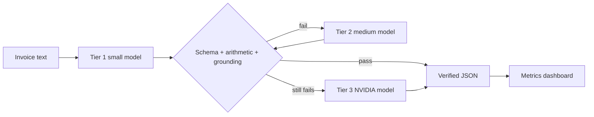

# RouteWise

RouteWise is a cost-aware, verified LLM router for invoice extraction. It tries a small Nebius-hosted open model first, applies deterministic checks, and escalates only when verification fails.

## Current status

The end-to-end repository is implemented: reproducible synthetic data generation, typed invoice schema, layered verifier, cost calculator, async Nebius client/router, escalation-classifier module, live evaluator, FastAPI contract, React dashboard, tests, CI, Docker/Render/Netlify manifests, demo script, and Devpost copy. Live metrics are intentionally absent until `NEBIUS_API_KEY` is supplied and the evaluation is run. No benchmark numbers in this repository are fabricated.

## Architecture



## Quick start

```bash
python3 -m venv .venv && source .venv/bin/activate
pip install -e '.[dev]'
python -m routewise.data --output data
pytest -q
```

For live model calls, copy `.env.example` to `.env`, set `NEBIUS_API_KEY`, review `models.yaml`, then run:

```bash
python -m routewise.eval --config models.yaml
uvicorn backend.app:app --reload --port 8000
cd frontend && npm install && npm run dev
```

The API exposes `GET /health`, `GET /metrics`, `POST /route`, `POST /compare`, and `POST /route/stream`.

## Model configuration

Model IDs and prices live in `models.yaml`, not application code. The initial values are sourced from the Nebius Token Factory model catalog cross-check recorded in [`docs/research.md`](docs/research.md). Prices can change; verify them against the account catalog before submitting benchmark results.

## Limitations

The generated data is synthetic and the test set is intentionally small. Model accuracy, cost, and latency must be measured with a real configured Nebius account. The live evaluation runner currently fails explicitly when the key is missing rather than silently substituting mocked results.
